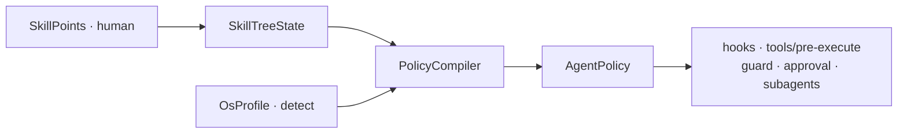

# agent-skilltree

**狀態：M0 scaffold（PolicyCompiler ＋ OsProfile ＋ MVP 36／OS 節點）——唔係生產完整 UI／Gateway。**

把 Vision／Search／工具額度／Soul／Consent／Safety 等做成 **可分配技能點**；點數經 **PolicyCompiler** 編成 **AgentPolicy**，再由 plugin hooks（`tools/pre-execute` 等）執行——唔係純裝飾 UI。

公開名：`agent-skilltree`。宿主 pin：`@deepseek-ai/dsh@0.2.1-rc.5`。  
**Not affiliated** (not affiliated) with DeepSeek、xAI、Blizzard、Cursor 或其他 LLM／遊戲廠商。技能樹介面為原創實作，互動隱喻上受經典 **ARPG** skill-tree UX 啟發。

## English (short)

M0 **policy-first** skill tree for a DSH-compatible agent: `SkillPoints → PolicyCompiler → AgentPolicy → hooks`. MVP **36** nodes (Perception 10 / Execution 14 / Governance 12) plus OS add-ons (**Path Hygiene I**, **Shell Dialect I**, **Strict Path Mode** default On on win32). Host plugin stub registers `skilltree.allocate|respec|inspect|export`. UI is a static token preview. MIT. No secrets in repo.

## 架構



## M0 有咩／未有咩

| 有（real） | Stub／後置 |
|------------|------------|
| `skills/mvp-36.yaml` ＋ loader | 華麗三 Tab 互動 UI |
| `detectOsProfile` / `PolicyCompiler.compile` | 產品 Gateway Persistent／Fleet 生命周期 |
| `pathHygieneCheck`（allow\|deny\|ask，**唔靜默 rewrite**） | 完整 Cordis typed Host |
| `allocate`／`respec`／`inspect`／`export`（禁 agent 自解鎖危險） | NSFW 宿主 API（產品層旗標 only） |
| Immutable Constitution constants | Art 節點圖示資產（只 tokens＋preview） |
| `dsh.bundle` ＋ `cordis.patch.yml` insert | public install 路徑（等上架後） |

## 本機檢查

```bash
cd /path/to/agent-skilltree
npm ci
npm run check   # build + vitest + hygiene/secret fallback
```

Install into a DSH profile（上架後／本機 path）：

```bash
# TBD after public — typical pattern:
# export DSH_HOME=...
# dsh plugin add /path/to/agent-skilltree
# （需要 dsh.bundle.patch → 先當 profile layer，唔好只當 plain dep）
```

## UI preview

Open [`ui/preview.html`](ui/preview.html) in a browser — tabs Perception／Execution／Governance + node state classes from [`ui/tokens.css`](ui/tokens.css)（Art pack；**唔含**第三方商標資產）.

## License

MIT · see [LICENSE](LICENSE) · [NOTICE](NOTICE)
