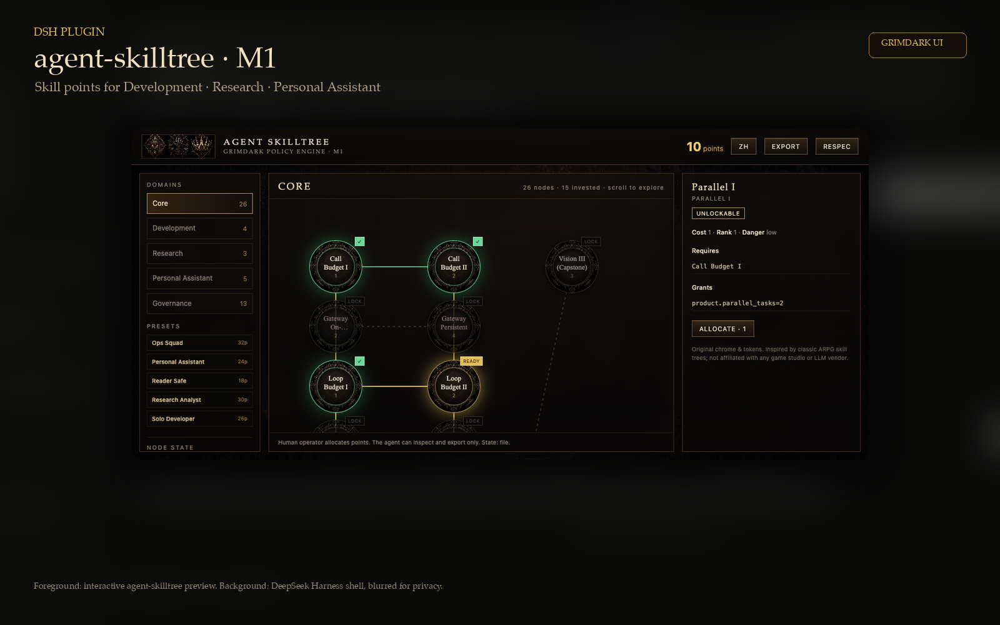
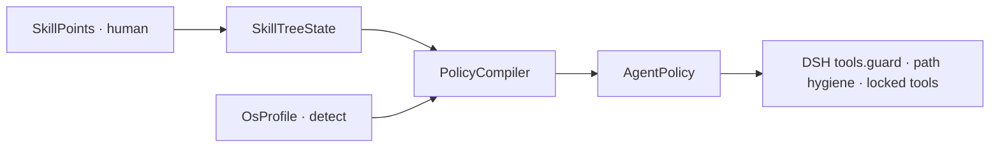

# agent-skilltree

**Status: M1 — policy-first skill tree for DeepSeek Harness (DSH).**

Allocate human-granted **skill points** across Development, Research and Personal Assistant nodes;
a **PolicyCompiler** turns the resulting `SkillTreeState` into an `AgentPolicy`; a real
`ctx.tools.guard` enforces path hygiene and locked sensitive tools. The agent can only inspect and
export — it can never allocate its own permissions.



Host pin: `@deepseek-ai/dsh@0.2.1-rc.5`. Public name: `agent-skilltree`. MIT. No secrets in repo.

**Not affiliated** (not affiliated) with DeepSeek, xAI, Blizzard, Cursor or any LLM/game vendor. The skill-tree UI is
an original implementation; the interaction metaphor is inspired by classic ARPG skill trees.

---

## Why this exists

A flat tool allowlist is either too permissive or too blunt. This project makes capability a
**budgeted, human-owned tree**:



```
SkillPoints (human) → SkillTreeState → PolicyCompiler → AgentPolicy → DSH guard
```

- A point spent on **Development → Safe Patch** produces `toolAsk: patch`, not a silent grant.
- **Personal Assistant → Send Email** stays `toolAsk: email_send`; it is never auto-approved.
- **Governance → Strict Path Mode** turns on path-hygiene checks; Windows paths on macOS are denied.
- The agent cannot grant points, respec, unlock dangerous nodes, or clear the constitution.

## Domains and nodes

| Domain | Nodes |
|---|---|
| **Core** | perception (vision/search/memory/files), execution (tools, budgets, parallel, subagents) |
| **Development** | Repo Read, Safe Patch, Test Runner, Release |
| **Research** | Citation Check, Scholar Search, Research Synthesis |
| **Personal Assistant** | Inbox Read, Calendar Read, Draft Reply, Send Email, Schedule |
| **Governance** | consent, safety, audit, respec, build export, strict path mode |

51 nodes total. The YAML catalog is [`skills/mvp-36.yaml`](skills/mvp-36.yaml).

## Presets (human builds)

| Preset | Points | What the agent can do | Human approval |
|---|---:|---|---|
| [`solo-dev`](presets/solo-dev.yaml) | 26 | Read repos, run tests, propose safe patches, summarise diffs | `patch`, `release` |
| [`research-analyst`](presets/research-analyst.yaml) | 30 | Search, verify citations, read scholarly sources, synthesise | outbound network |
| [`personal-assistant`](presets/personal-assistant.yaml) | 24 | Read inbox/calendar, draft replies, propose schedules | `email_send`, `calendar_write` |
| [`ops-squad`](presets/ops-squad.yaml) | 32 | Fan out to subagents, run parallel operations | shell / write / network |
| [`reader-safe`](presets/reader-safe.yaml) | 18 | View images, search, read files, summarise only | write / shell / network |

Every preset carries `agent_purpose_zh` / `agent_purpose_en` so the operator knows exactly what the
agent is for — not just which nodes are lit. Details: [`docs/operations.md`](docs/operations.md).

## Quick start

```bash
npm ci
npm run check                 # build + 20 vitest + hygiene/secret fallback
npm run ui:data               # generate ui/nodes.js from the YAML catalog
npm run skilltree -- presets  # list human builds
npm run skilltree -- preset solo-dev
npm run ui:serve              # http://127.0.0.1:8780/preview.html
```

State defaults to `~/.dsh/skilltree-state.json` (atomic write, mode 0600). Override with
`SKILLTREE_STATE=/path`. The CLI and UI server share the same file; the DSH plugin reads it on every
guard call.

## Install into DSH (tested locally)

```bash
cp -a ~/.dsh/profiles/headless ~/.dsh/profiles/skilltree-test
dsh plugin --profile skilltree-test add /path/to/agent-skilltree
dsh --profile skilltree-test --dump-config   # shows "# == agent-skilltree"
dsh --profile skilltree-test --help          # loads without crash
```

The plugin is a `dsh.bundle.patch` layer; a linked install warns that peer dependencies are not resolved; they are optional in M1. Use `file:`
or a registry install for production. See [`docs/operations.md`](docs/operations.md) for rollback.

## What is actually effective

| Layer | Status |
|---|---|
| `PolicyCompiler` (SkillTreeState → AgentPolicy) | ✅ real; 20 tests |
| `pathHygieneCheck` (Path Hygiene + Shell Dialect; allow/deny/ask; never rewrites argv) | ✅ real |
| `ctx.tools.guard` (path hygiene + locked sensitive tools) | ✅ real; **live DSH task refused `copy C:\...`** |
| `skilltree_inspect` / `skilltree_export` | ✅ executable read-only tools; **live inspect verified** |
| Human CLI `grant` / `allocate` / `respec` / `preset` | ✅ real |
| Persistent state shared by CLI / UI / plugin | ✅ real |
| Interactive grimdark UI | ✅ static HTML/JS; Grok Imagine art |
| `ask` approval flow | ✅ pre-execute returns `{kind:'ask'}`; DSH runs its approval card. Headless has no channel, so it denies. |
| turnCap / subagent / sandbox runtime enforcement | ⚠️ partial: shell/write/subagent denial, sandbox floor, and active-subagent count (pre/post) are enforced; turnCap is host-unsupported |
| Cordis client UI / product Gateway | ❌ later |

## Verified end-to-end

With `DEEPSEEK_API_KEY` in the launching environment and the `skilltree-test` profile:

```text
Default tree:
Use the bash tool to run exactly: printf SKILLTREE_OK
→ refused: "skilltree: shell is not permitted by the current policy. Allocate Shell Consent first."

After `npm run skilltree -- preset ops-squad` (Shell Consent unlocked, approval = ask):
Use the bash tool to run exactly: printf SKILLTREE_OK
→ approval requested; headless has no approval channel, so the command does NOT run
  (in the DSH web UI the approval card is shown; Allow once → runs, Reject → denied)

Use the bash tool to run exactly: copy C:\foo\bar.txt D:\x.txt
→ refused before bash: "skilltree: windows_path_on_posix"
   (agent did not retry with a translated path)

Use the skilltree_inspect tool and report policy.toolDeny
→ ["email_send", "calendar_write"]
```

This proves the plugin is mounted, the read-only tool executes, shell is denied without consent,
`ask` reaches DSH's approval waterfall, and a policy-violating path is blocked in a live agent turn.

## UI

- `ui/preview.html` — interactive tree: 5 domain tabs, state badges (`READY` / `LOCK` / `PREREQ` / `✓`),
  prerequisite edges, inspector, allocate/respec/export.
- **Feel**: synthesized WebAudio cues (allocate chime, deny thud, respec sweep, preset chord) with a
  `SFX` toggle; node pop, point-count pulse, deny shake; optional `navigator.vibrate` / WebView haptic
  bridge. No audio assets to download; respects mute.
- **In DSH (live-verified)**: `dsh.client` adds a `✦ Skill Tree` button to the composer dock; it opens the
  UI in a portal modal iframe backed by the plugin's loopback server at `127.0.0.1:8780`. Verified in the
  live DSH web profile: client bundle loaded, button rendered, iframe opened, English tree visible.
- `npm run ui:serve` — local server on `127.0.0.1:8780`, with `GET/POST /api/state` so the UI writes the
  same `skilltree-state.json` as the CLI and plugin.
- Art: `ui/assets/background-grimdark.png`, `node-frame.png`, `sigils.png` — generated with **Grok
  Imagine** (xAI), original, no third-party IP.
- Composite preview: `ui/preview-dsh-en.png` (English; DSH shell **lightly** blurred behind the plugin UI; no usage text readable).
- Chinese preview: `ui/preview-dsh.png`. The UI follows the DSH/browser language; `?lang=en` / `?lang=zh` overrides.

## Documentation

- [`docs/operations.md`](docs/operations.md) — install, presets, CLI, UI server, state, troubleshooting.
- [`docs/m1-limits.md`](docs/m1-limits.md) — what M1 does not enforce yet.
- [`docs/builds/`](docs/builds/) — older reference builds (YAML + preview art).

## License

MIT — see [LICENSE](LICENSE) and [NOTICE](NOTICE).
